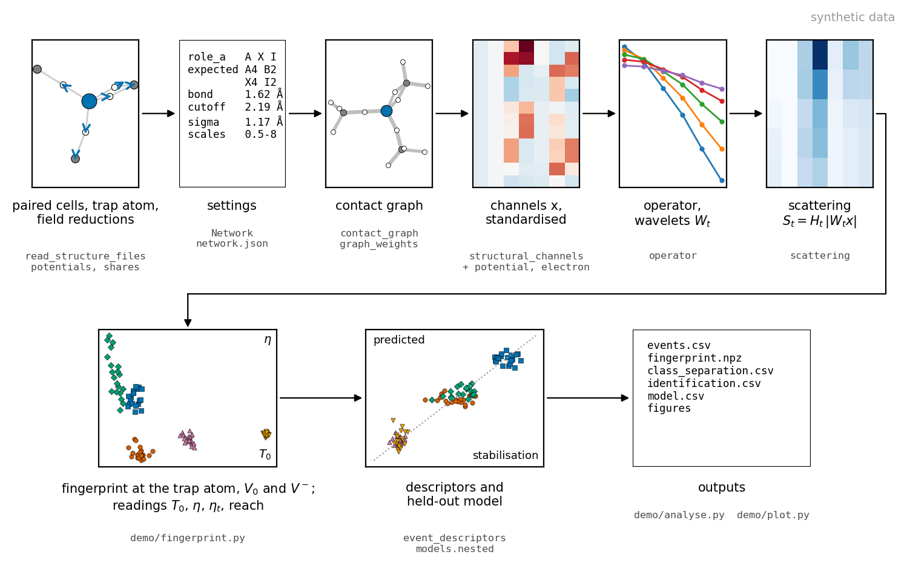

# sa-gw: state-aligned graph wavelets

Graph-wavelet fingerprints of trapping events in disordered networks: a scattering transform on the contact graph of a cell,
read at the trap atom before and after relaxation, with structural, potential and electron channels.

    pip install -r requirements.txt
    pytest -q
    bash demo/run.sh            # example data -> fingerprint -> analysis -> figures in demo/out/ (one minute)

A material enters through one settings object, saved beside the data and read by every script:

```python
from sagw.network import Network
net = Network.from_structures(role_a=('Si', 'Ge'), expected={'Si': 4, 'Ge': 4, 'O': 2}, ideal_cosine={'Si': -1 / 3, 'Ge': -1 / 3, 'O': -0.8},
                              symbols=sym, positions=pos[:, 0], cells=cell)        # bond length and cutoff measured from the neutral cells
net.save('network.json')
```


*The workflow on one example cell: paired structures and field reductions, the settings, the contact graph, the standardised
channels, the operator and its wavelets, the scattering coefficients; the fingerprint at the trap atom and its readings, the
descriptors and the held-out model, the outputs.*

The steps, from settings to figures: [docs/tutorial.md](docs/tutorial.md).

    sagw/network.py        settings: roles, coordinations, angles, bond length, cutoff, weight, scales, radii
    sagw/structures.py     structure files, minimum-image geometry, displacement fields
    sagw/graph.py          contact graph, diffusion operator, wavelets, scattering coefficients, structural channels
    sagw/descriptors.py    structural response descriptors of an event
    sagw/models.py         held-out regression on descriptor blocks
    sagw/potential.py      electrostatic potential grid -> potential at the site and over the shell of every atom
    sagw/spin.py           spin-density grid and Mulliken populations -> share of the added electron; relocation
    example/               make_example.py and data/ with its network.json
    demo/                  fingerprint.py, analyse.py, plot.py, schematic.py, style.py, run.sh
    tests/                 pytest

Licence: MIT (Olsson Materials Modelling).
