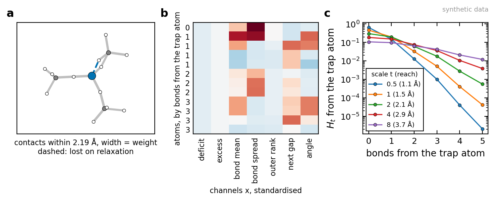
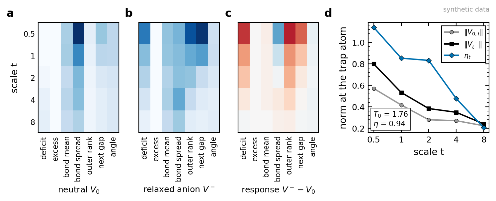
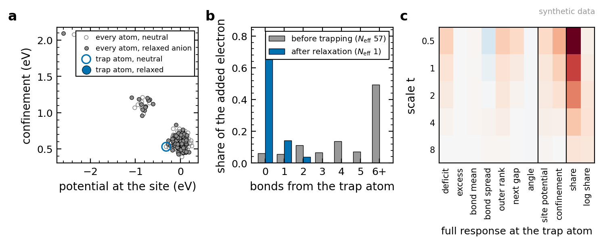
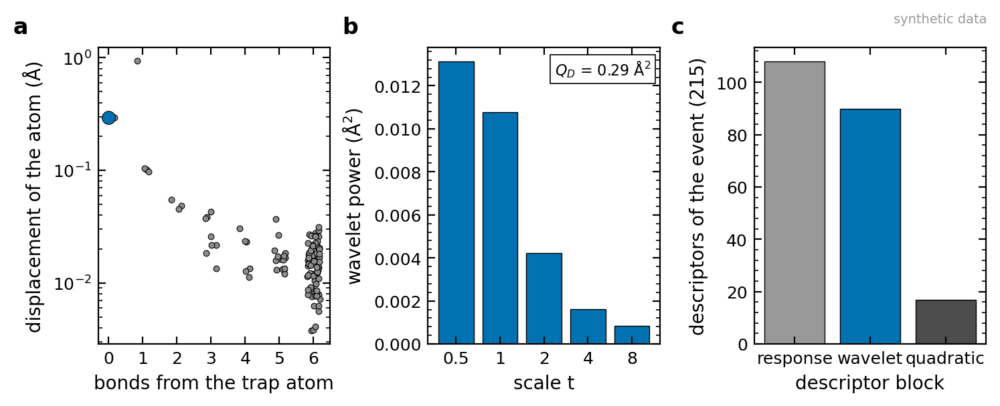
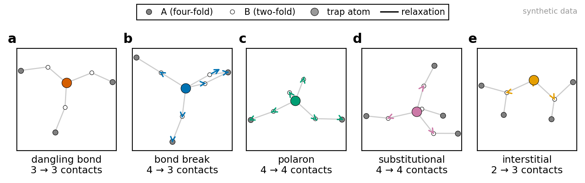
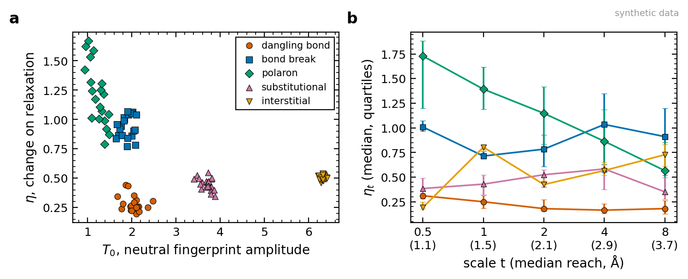
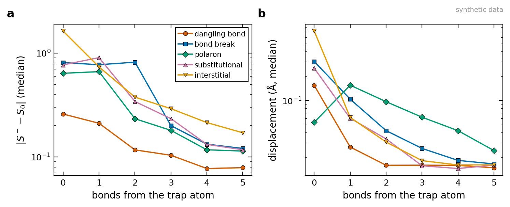
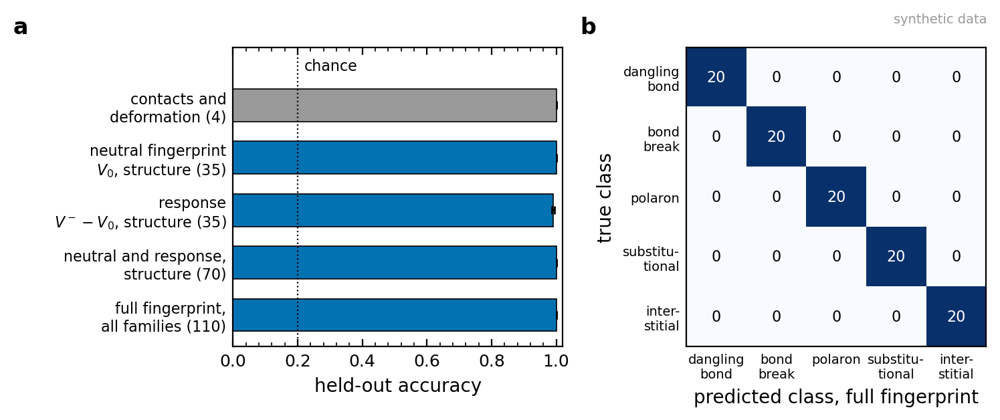
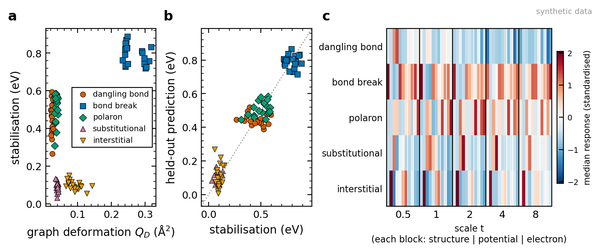

# Tutorial

Every step below runs on the example data; `bash demo/run.sh` runs them all.  Paths are relative to the repository.


## 1. Settings

```python
from sagw.network import Network
net = Network.from_structures(role_a=('Si', 'Ge'), expected={'Si': 4, 'Ge': 4, 'O': 2}, ideal_cosine={'Si': -1 / 3, 'Ge': -1 / 3, 'O': -0.8},
                              symbols=sym, positions=pos[:, 0], cells=cell)
net.save('network.json')
```

- `role_a`: the species that bond to the rest (network formers, substitutional impurities, interstitials bonding to the other
  role).  Contacts join atoms of unlike role.  A species bonding to both roles needs a second symbol.
- `expected`: nominal coordination per species; sets the deficit and excess channels and the rank of the outer-rank and next-gap
  channels.  A wide coordination range keeps the nominal value; two distinct environments get two symbols.
- `ideal_cosine`: cosine of the ideal bond angle per species (tetrahedral -1/3, trigonal -1/2, linear -1, a bridging anion its
  typical angle).
- Cutoff and weight width: `from_structures` reads the bond length from the first peak of the unlike-pair distances and the cutoff
  from the middle of the first gap; `from_bond_length` uses `RATIOS` (1.35 and 0.72 bond lengths).  Check the cutoff on a histogram
  of those distances: in the gap between the first and second shell, every atom keeping a contact.  Denser networks move it in.
- `scales`: diffusion times of the wavelets; their reach in angstrom is written per cell (`demo/out/scale_radius.csv`), 0.7 to 2.3
  bond lengths for 0.5 to 8.  Extend them for longer-ranged responses.
- Radii of the descriptor spheres and of the potential's site and shell scale with the bond length by `RATIOS`; override when the
  coordination shells sit elsewhere.

## 2. Inputs

Paired structure files `structures/q0/<cell>.extxyz` and `structures/q-1/<cell>.extxyz`; a table naming the trap atom of each
cell (the atom carrying the largest share of the added electron at the relaxed geometry); and two per-atom reductions of the fields:

```python
from sagw.potential import potentials, well                      # potential at the site and over the shell, referenced to the species mean
from sagw.spin import voronoi_integral, shares, carries           # share of the added electron per atom; whether the trap atom carries it
site, shell = potentials(open('v_hartree.cube', 'rb').read(), symbols, net); depth, confinement = well(site, shell)
```

## 3. Graph, channels, operator

```python
from sagw.structures import read_structure_files, distances
from sagw.graph import contact_graph, graph_weights, operator, structural_channels
boxes, sym, cell, pos = read_structure_files('example/data/structures')
d = distances(pos[b, 0], cell[b]); w = graph_weights(d, contact_graph(d, net.role_of(sym[b]), net), net)
x = (structural_channels(pos[b, 0], cell[b], sym[b], net) - mu) / sd      # standardised over the population
H = operator(w)
```


*(a) The contact graph around the trap atom; the dashed contact is lost on relaxation. (b) The standardised channels of the atoms
within three bonds. (c) The operator from the trap atom at each scale.*

## 4. Fingerprint and readings

```python
from sagw.graph import scattering
S = scattering(H, x, net.scales)        # (atoms, scales, channels)
V0 = S[trap]                            # V- from the relaxed anion the same way
```

T0 = sum_t ||V0_t||; eta = ||V- - V0|| / ||V0||; eta_t by scale; reach by bonds from the trap atom (`bonds_from`).
`demo/fingerprint.py` does this for every cell and writes `demo/out/events.csv` and `fingerprint.npz`.



## 5. Potential and electron families

The site potential, the confinement, the electron share and its logarithm are appended to `x`, centred by role, and pass through
the same operator: 11 channels at 5 scales per endpoint.


*(a) Potential at the site against confinement for every atom at both endpoints. (b) Share of the added electron by bonds from the
trap atom, before trapping and after relaxation. (c) The full response at the trap atom.*

## 6. Displacement and descriptors

```python
from sagw.structures import displacement
from sagw.descriptors import event_descriptors
u = displacement(pos[b, 0], pos[b, 1], cell[b])
X = event_descriptors(pos[b, 0], pos[b, 1], cell[b], sym[b], trap, net)   # 215 descriptors; sagw.models.nested fits them held out
```


*(a) Displacement by bonds from the trap atom. (b) Its wavelet power by scale and the graph deformation Q_D. (c) The descriptor
blocks.*

## 7. The example classes

100 network glasses (four-fold A bridged by two-fold B), one event each of five kinds, each with its own level, localisation and
well (`example/data/README.md`).



*(a) Empty level before trapping and occupied level after relaxation. (b) Atoms carrying the electron before and after. (c) The
potential at the trap atom before and after.*

## 8. Readings across classes

A trap that changes the contact graph moves the deficit and excess channels and responds at the shortest scales; T0 marks
sites that differ before the event.  A polaron keeps every contact: its response is in the bond-length and angle channels, spread
over shells, so read eta_t, the reach, and the potential and electron families.  An impurity with a fixed level is marked by the
neutral fingerprint and the potential family; its response is small.




## 9. Identification and separation

`demo/analyse.py` identifies the class held out from each reading and scores every pair (`demo/out/identification.csv`,
`class_separation.csv`).




## 10. Energetics and signature


*(a) Stabilisation against graph deformation. (b) Held-out prediction from the descriptors: R² 0.93, against 0.35 for Q_D alone
and 0.95 for Q_D with the class (`demo/out/model.csv`). (c) The median response of each class, every event scaled to unit size.*

Regenerate the data with `bash demo/run.sh remake` (fifteen minutes, deterministic).
