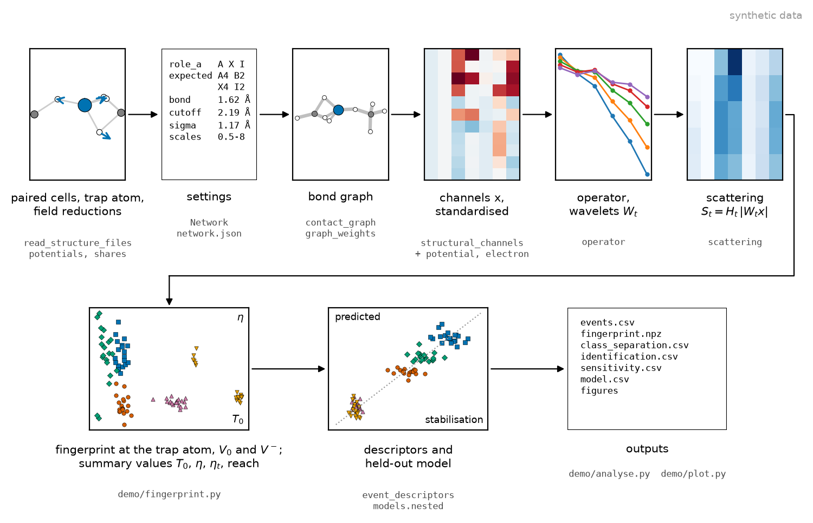
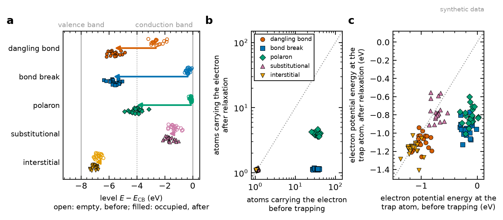
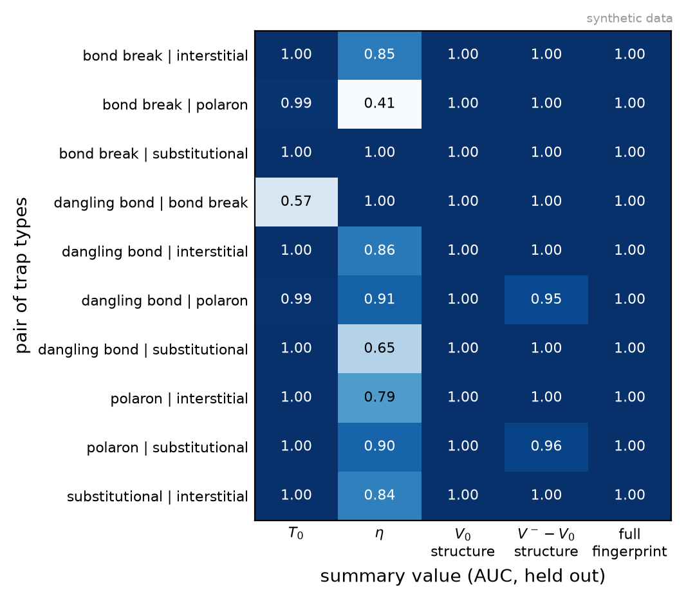

# Tutorial

`bash demo/run.sh` runs every step below on the synthetic example in `example/data`.  For your own data, copy the demo scripts and
point `DATA` at your folder.



## 1. Calculations

Four single points per event, on the same cell:

| Geometry | Charge | Provides |
|---|---|---|
| neutral, relaxed | 0 | `structures/q0`, potential before trapping |
| neutral, relaxed | −1 | spin before trapping |
| charged, relaxed | −1 | `structures/q-1`, spin after trapping |
| charged, relaxed | 0 | potential after trapping |

Write the potential with CP2K `V_HARTREE_CUBE` and the spin as a cube or Mulliken populations.  Take the potential from the neutral
state only: a q−1 cube contains the added electron's own potential.

## 2. Files

    structures/q0/<cell>.extxyz     neutral structure
    structures/q-1/<cell>.extxyz    charged structure, same atoms in the same order; all cells the same size
    events.csv                      cell, kind (trap type), trap_atom (1-based), outcomes such as stabilisation_eV
    potentials.npz                  cells; site_eV, shell_eV (cells x 2 x atoms)
    electron.parquet                cell, state (P before, T after trapping), atom, share
    network.json                    settings

The trap atom carries the largest share of the added electron in the charged structure.

## 3. Settings

```python
from sagw.network import Network
from sagw.structures import read_structure_files
names, sym, cell, pos = read_structure_files('structures')
net = Network.from_structures(role_a=('A',), expected={'A': 4, 'B': 2}, ideal_cosine={'A': -1 / 3, 'B': -0.82}, symbols=sym, positions=pos[:, 0], cells=cell)
net.save('network.json')
```

- `role_a`: the A species; all others are B.  A bond is an A-B pair closer than the cutoff.
- `expected`, `ideal_cosine`: coordination and ideal bond-angle cosine of each species.
- `from_structures` measures the bond length and cutoff on the neutral cells; `Network.from_bond_length` sets them from a bond length.
- Optional: `scales`, `smooth`, `reference`, `field_smoothing`, `core_radius` (`sagw/network.py`).

## 4. Field reductions

```python
import numpy as np
from sagw.potential import potentials, read_cube
from sagw.spin import voronoi_integral, mulliken_spin, shares
site, shell = potentials(open('neutral.cube', 'rb').read(), sym[b], net)                               # eV per atom
field, step, _, xyz = read_cube(open('spin.cube', 'rb').read()); share, n_eff = shares(voronoi_integral(np.abs(field), step, xyz))   # or shares(mulliken_spin(text)[1])
```

Save `site` and `shell` of both structures of every cell in `potentials.npz`, and the shares in `electron.parquet`.


*(a) Site potential against confinement, every atom. (b) Share of the added electron by bonds from the trap atom. (c) Change of every
channel at the trap atom.*

## 5. Fingerprints

```bash
python3 demo/fingerprint.py      # demo/out/events.csv, demo/out/fingerprint.npz
```

For one cell `b` with trap atom `j`, structural channels only:

```python
from sagw.structures import distances
from sagw.graph import structural_channels, standardise, contact_switch, graph_weights, operator, scattering, readings
F = np.stack([[structural_channels(pos[c, q], cell[c], sym[c], net) for q in range(2)] for c in range(len(names))])
Z = standardise(F, net.role_of(sym))
V = []
for q in range(2):
    d = distances(pos[b, q], cell[b]); H = operator(graph_weights(d, contact_switch(d, net.role_of(sym[b]), net), net))
    V.append(scattering(H, Z[b, q], net.scales)[j])
T0, eta, eta_t = readings(*V)
```

T0 is the fingerprint amplitude before trapping, eta its relative change on trapping, eta_t that change by scale.  The reach of
each scale is in `demo/out/scale_radius.csv`: 0.7 to 2.3 bond lengths for t = 0.5 to 8.


*(a) Bonds around the trap atom; dashed: broken on relaxation. (b) Standardised channels near the trap atom. (c) Diffusion from the
trap atom by scale.*


*Fingerprint at the trap atom before (V0) and after (V−) trapping, its change, T0 and eta.*


*(a) T0 against eta. (b) eta_t by scale.*


*Change of the fingerprint (a) and displacement (b) by bonds from the trap atom.*

## 6. Descriptors and the energy model

```python
import pandas as pd
from sklearn.model_selection import StratifiedKFold
from sagw.descriptors import event_descriptors
from sagw import models
ev = pd.read_csv('events.csv'); trap, kind, y = ev.trap_atom.to_numpy() - 1, ev.kind.to_numpy(), ev.stabilisation_eV.to_numpy()
X = pd.DataFrame([event_descriptors(pos[c, 0], pos[c, 1], cell[c], sym[c], trap[c], net) for c in range(len(names))]).to_numpy(float)   # 215 per event
fold = np.zeros(len(X), int)
for f, (_, test) in enumerate(StratifiedKFold(5, shuffle=True, random_state=0).split(X, kind)): fold[test] = f
pred, chosen, _ = models.nested({'descriptors': X}, [('ridge', a) for a in np.logspace(-3, 2, 16)], y, kind, fold, 0)
```

`pred` is the held-out prediction of `y`.  Held-out R² of the stabilisation energy: 0.93 from the descriptors, 0.23 from Q_D alone
and 0.96 from Q_D with the trap type.


*(a) Displacement by bonds from the trap atom. (b) Wavelet power by scale and the graph deformation Q_D. (c) Descriptor blocks.*


*(a) Stabilisation energy against Q_D. (b) Held-out prediction. (c) Median response of each trap type.*

## 7. Cutoff sensitivity

```python
from sagw.sensitivity import sensitivity
summary, flips = sensitivity(sym, pos, cell, trap, net, factors=(0.95, 1.05))
```

On the example, scaling the cutoff by 0.95 and 1.05 changes the bond count of the trap atom in 4 and 0 of the 100 events; Spearman ρ
of every summary value against the unscaled settings stays at or above 0.93.  Scaling σ by the same factors keeps it at or above
0.99.

## 8. Trap types

`python3 demo/analyse.py` identifies the trap type of every event, held out, and scores every pair of types.  The example's types are
defined by the bond counts and species of the trap atom, so these scores show what each quantity captures, not performance.


*The median-eta event of each trap type; arrows: relaxation.*


*(a) Levels before and after trapping. (b) Atoms carrying the electron. (c) Site potential at the trap atom.*


*Held-out accuracy of trap-type identification, and the confusion matrix of the full fingerprint.*


*Held-out AUC of every summary value for every pair of trap types.*

Figures: `bash demo/run.sh figures`.  Example data: `bash demo/run.sh remake` (twelve minutes; deterministic for given NumPy and SciPy
versions).
